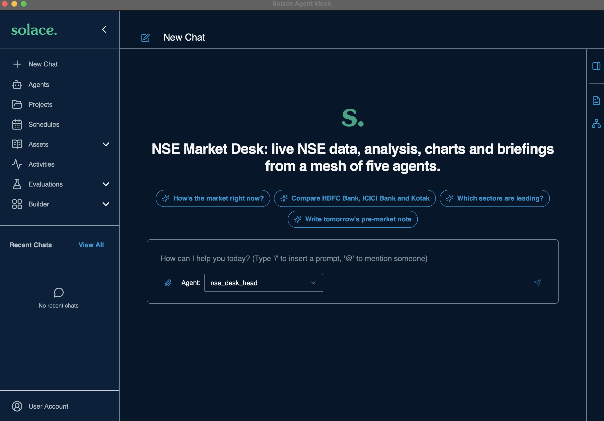
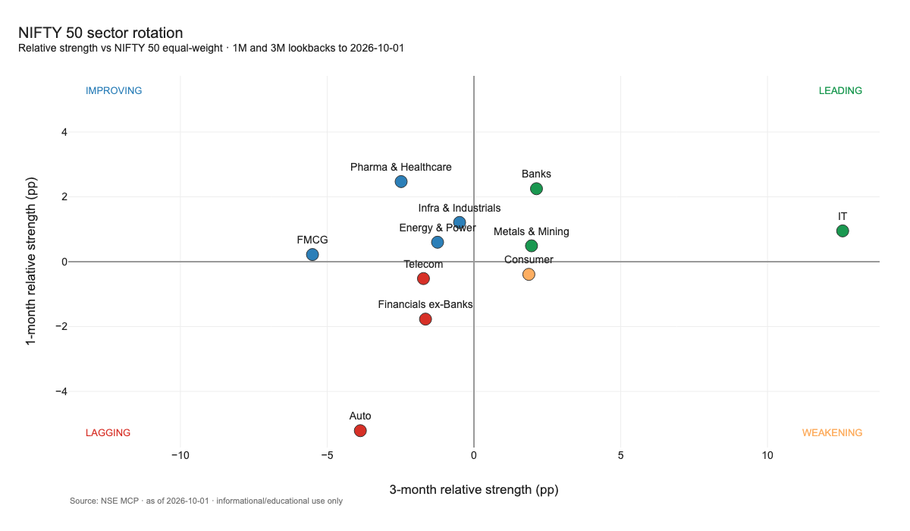

# NSE Market Desk on Solace Agent Mesh

Build and run your own team of AI agents for the Indian stock market, on your own machine, in
about ten minutes.

Five small agents work together over [Solace Agent Mesh](https://docs.solace.com/Agentic-AI/agent-mesh.htm)
(SAM), using the official [NSE MCP server](https://www.nseindia.com/nse-mcp) as their data source.
Ask a question in plain English and the agents hand work to each other: one fetches live and
end-of-day data from NSE, one calculates sector rotation and breadth, one draws charts, and one writes
a pre-market note or end-of-day wrap as a PDF. Each agent is a single YAML file. They find each other
through agent cards on SAM's event broker and delegate over A2A, with no integration code between them.

<p align="center">
  <br>
  <em>What you see when SAM Desktop opens with the desk applied: a welcome screen, four one-click starter prompts, and the Desk Head ready to chat</em>
</p>

<p align="center">
  <br>
  <em>A chart drawn by the Chart Studio agent (NIFTY 50 sector rotation, data as of 1 Oct 2026)</em>
</p>

```
You ─► nse_desk_head (orchestrator)
         ├─► nse_market_data ──► NSE MCP (nse_bhavcopy + nse_cm_market connectors)
         ├─► nse_market_analyst ──► nse_market_data      (+ nse_analytics Python toolset)
         ├─► nse_chart_studio                              (built-in Plotly chart tool)
         └─► nse_briefing_writer ──► analyst, market data, chart studio  (+ nse_publishing, html_to_pdf)
```

| Agent | What it does | Tools |
|---|---|---|
| `nse_desk_head` | Front door: routes your question, posts a short plan and live progress, gives numbers-first answers | the other four agents |
| `nse_market_data` | The only agent that talks to NSE: live movers and quotes, breadth, history, comparisons, corporate actions | 2 NSE MCP connectors (21 tools) |
| `nse_market_analyst` | Sector rotation (1-month vs 3-month quadrants), momentum, breadth trend, live sector tilt | `nse_analytics` Python toolset + a methodology skill |
| `nse_chart_studio` | PNG charts in one consistent style | built-in Plotly chart tool + a style skill |
| `nse_briefing_writer` | Pre-market note and end-of-day wrap, in chat and as a PDF | `nse_publishing` toolset + `html_to_pdf` + a template skill |

## Get started in 5 steps

1. [Download SAM Desktop and the `sam` CLI](#1-download-sam-desktop-and-the-sam-cli-free)
2. [Clone this repo](#2-clone-this-repo)
3. [Configure your model](#3-configure-your-model)
4. [Apply the config to SAM](#4-apply-the-config-to-sam)
5. [Try the sample prompts](#5-try-the-sample-prompts)

### 1. Download SAM Desktop and the `sam` CLI (free)

1. Go to **https://solace.com/products/agent-mesh/download/** and download Agent Mesh for your
   operating system (macOS, Windows or Linux). It is free to download and try; the download page
   describes it as free for individuals and for companies with under $25M annual revenue, so check the
   page for the current terms.
2. Install it and start **Solace Agent Mesh** once to make sure it opens. It bundles its own event
   broker, so there is nothing else to install. The app window is the chat UI; the `sam` CLI talks to the
   app's local API on port 8800.
3. The download also includes the **`sam` command-line tool**, which this repo uses for all setup.
   Put it on your `PATH` and check that it works:

   ```bash
   sam --version
   ```

4. You also need **Python 3.10+** (`python3 --version`) with `pip` and internet access.
   `sam config apply` builds two small Python toolsets on your machine and downloads their
   dependencies from PyPI.

Tested with SAM Desktop 2.325.2 and `sam` 2.275.10 on macOS. Windows and Linux should work with the
same commands but are untested.

> **Don't confuse it with `pip install solace-agent-mesh`.** That installs an older Python framework,
> a different product with no desktop app and no `sam config apply`. This repo needs the desktop app
> and CLI from the download page above.

### 2. Clone this repo

```bash
git clone https://github.com/himoacs/nse-market-desk-agent-mesh.git
cd nse-market-desk-agent-mesh
```

### 3. Configure your model

The agents need an LLM, and you supply your own. Copy the template and fill it in:

```bash
cp .env.example .env          # Windows: copy .env.example .env
```

Open `.env` in an editor. It is gitignored, so your key never gets committed.

| Variable | What to put | Example |
|---|---|---|
| `LLM_PROVIDER` | `custom` for any OpenAI-compatible endpoint such as a LiteLLM gateway (the tested setup), or a SAM provider name such as `openai` or `anthropic` | `custom` |
| `LLM_MODEL_NAME` | The model name. With `custom`, start it with the API format your endpoint speaks: `anthropic/<model>` or `openai/<model>`. With a built-in provider, use the plain model name | `anthropic/claude-sonnet-5-5` |
| `LLM_API_BASE` | Your endpoint's base URL **without** a trailing `/v1`. Required for `custom`; for `openai`, `anthropic` and the other built-in providers, leave it empty or delete the line | `https://my-gateway.example.com` |
| `LLM_API_KEY` | Your API key | `sk-...` |

Which setup to use:

| Setup | Status |
|---|---|
| `custom` + an OpenAI-compatible gateway (e.g. LiteLLM) serving Claude Sonnet 5.5 | Tested end to end |
| `custom` + an OpenAI-compatible gateway serving other models (`openai/<model>`) | Not tested |
| `openai` or `anthropic` directly, with `LLM_API_BASE` left empty | SAM accepts this config (checked); not run end to end |

Use a strong tool-calling model. The agents hand work to each other and call many tools, and small or
weak models tend to stumble on that. See SAM's
[model docs](https://docs.solace.com/Agent-Mesh/Framework/building/models/index.htm) for the
providers it supports.

This sets `nse_sonnet`, the model all five desk agents use. SAM's own built-in `general` and `planning`
models (used by SAM's Builder and for chat titles) are separate and are left alone by default. If you
want them to use your LLM too, add `--builtin-models` in step 4. That overwrites those two models.

### 4. Apply the config to SAM

1. **Start SAM Desktop** and wait until its chat screen appears.
2. From the repo folder, run:

   ```bash
   python3 scripts/bootstrap.py          # Windows: python scripts\bootstrap.py
   ```

It usually takes under a minute and does everything through the `sam` CLI:

- checks your `.env` and tells you if something is missing or still a placeholder;
- finds the running SAM Desktop (no login needed) and, if that instance already has other agents of
  yours, **asks before adding the desk next to them**. Nothing you already have is changed or deleted;
- runs `sam config apply --target desktop` for everything in `manifest.yaml`: the model, two NSE
  connectors, two Python toolsets (built locally), three skills and the five agents;
- creates the **NSE Market Desk** chat project (default agent: `nse_desk_head`) and two **scheduled
  tasks** (a pre-market note at 08:30 IST and an end-of-day wrap at 16:00 IST on weekdays) through
  `sam api`, because `sam config` has no resource type for those. The schedules are created
  **switched off**, so nothing calls your LLM on a timer until you turn them on.

You should end with:

```
project  + NSE Market Desk (default agent nse_desk_head)
schedule + NSE pre-market note: 30 8 * * 1-5 Asia/Kolkata -> nse_briefing_writer (disabled)
schedule + NSE EOD wrap: 0 16 * * 1-5 Asia/Kolkata -> nse_briefing_writer (disabled)

Done. In SAM Desktop open Projects > NSE Market Desk (or start a new chat) and try a prompt.
```

It is safe to re-run after you edit any YAML. Options:

| Flag | Effect |
|---|---|
| `--enable-schedules` | Switch the two scheduled tasks on (also possible on SAM's Schedules page) |
| `--builtin-models` | Also point SAM's `general` / `planning` models at your LLM (overwrites them) |
| `--remove-builtins` | Delete SAM's built-in Orchestrator and Activity Monitor agents; the Builder is kept |
| `--yes` | Don't ask before adding the desk to an instance that has other agents |
| `--skip-apply` | Only create/update the project and scheduled tasks |

**Prefer to run the SAM CLI yourself?** The core of it is two commands, run from the repo folder:

```bash
sam config plan  --target desktop -v     # preview what would change; changes nothing
sam config apply --target desktop        # apply manifest.yaml
```

`--target desktop` finds the running SAM Desktop on its own. The project and schedules live in
`instance/*.json` and are applied by `bootstrap.py` with `sam api`.

One thing that looks alarming but isn't: `plan` and `apply` list SAM's built-in `Orchestrator` and
`Activity Monitor` agents as `- delete`. They are only shown because they exist in SAM but not in this
repo. `apply` never deletes anything unless you pass `--prune`, which you shouldn't need here.

### 5. Try the sample prompts

In SAM Desktop, open **Projects → NSE Market Desk** and start a chat. The Desk Head is the default
agent, and its welcome screen (the screenshot at the top of this page) has one-click buttons for several of the prompts below. If you start a
plain **New Chat** instead, pick `nse_desk_head` from the agent menu.

Start with the quick ones, then work up:

| Try this | What the agents do | Typical time |
|---|---|---|
| Which agents do you have and what does each one do? | The Desk Head describes the team | ~10s |
| What was NSE market breadth on the latest trading day? | Market Data, one NSE call | ~15s |
| Live quote for Reliance | Market Data, live quote | ~20s |
| Show the top 5 BANK NIFTY gainers and losers right now | Market Data, live movers | ~25s |
| Any dividends, splits or bonuses for Reliance in the last year? | Market Data, corporate actions | ~20s |
| How's the market right now? | Live movers plus live sector tilt (Market Data + Analyst) | ~30s-1m |
| Compare HDFC Bank, ICICI Bank and Kotak Mahindra Bank over 6 months, with a chart. | Market Data → Chart Studio, returns vs drawdown chart | ~1.5m |
| Which NIFTY 50 sectors are leading over 1 month vs 3 months? Show the rotation chart. | Analyst asks Market Data for 10 comparisons in parallel, a Python tool does the maths, Chart Studio draws the quadrant | ~2m |
| Write today's EOD wrap. | Live sector tilt and leaders/laggards, written up and rendered to a PDF | ~3m |
| Write tomorrow's pre-market note. | All five agents: breadth trend, sector rotation, momentum, movers, 3 charts, a 2-page PDF | ~6m |
| Should I buy HDFC Bank now? | The desk declines to give advice and offers data instead | under 1m |

What to look for:

- **Live progress.** For multi-step questions the Desk Head posts a one-line plan, and each agent
  posts a short status line before every tool call or hand-off. Open the **Activity** panel with **Detail Mode** on to watch
  the agents pass work to each other.
- **Files.** Charts, CSVs and the finished PDF appear in the chat's **Files** panel.
- **Market hours.** Live data covers the NSE session, 09:15-15:30 IST, Monday to Friday. Outside those
  hours "right now" prompts answer with the last session and say so. NSE's live board also
  sometimes lists fewer than five losers (or gainers) for an index.
- **Speed and cost.** Times depend on your model and on NSE's servers, which sometimes hang; the
  Market Data agent retries each failed call up to 3 times. The two briefing prompts make dozens of LLM
  calls, noticeably more than a normal chat message, so try the quick prompts first.
- **Not advice.** Everything is informational and educational. See [Data and terms](#data-and-terms).

Command-line alternative: `sam task send "Live quote for Reliance" -a nse_market_data`

## Make it your own

Everything is plain YAML, so changing the desk is edit, then `python3 scripts/bootstrap.py`, then ask again:

- **Change how an agent behaves.** Edit the `systemPrompt` in any file under `agents/`, or the
  procedures in `skills/*/SKILL.md`, and re-apply.
- **Try a different model.** Change `.env` and re-apply, or give one agent its own model with
  `modelProvider` in its YAML.
- **Add an agent.** Copy an agent file, give it a new `name`, list it under `agents:` in
  `manifest.yaml`, and add it to the Desk Head's `allowList` so it can delegate to it. A natural
  first one is a corporate-actions specialist built on the `get_corporate_actions` tool.
- **Build one in the UI instead.** Chat with SAM's Builder agent to draft an agent, then bring it into
  YAML with `sam config pull --target desktop -o some-folder`.
- **Turn on the schedules.** `python3 scripts/bootstrap.py --enable-schedules`, then watch the runs on
  SAM's Schedules page.
- **Add stocks, sectors or indices.** The sector map is a small CSV; see below.

## How it works

- **Data travels as files.** Market Data saves every raw NSE response as an artifact. The Analyst's
  Python tools read those files and write CSVs. Chart Studio turns CSVs into PNGs. The Briefing Writer
  writes the note once as markdown; `render_note_html` turns it into styled HTML with the PNGs embedded,
  and `html_to_pdf` makes the PDF.
- **Deterministic maths.** Returns, relative strength, quadrants and breadth regimes are computed by
  the `nse_analytics` Python toolset, unit-tested on recorded NSE responses. The LLM decides what to
  fetch and how to explain it, never the arithmetic.
- **No sector data in NSE MCP.** `toolsets/nse_analytics/src/src/nse_analytics/data/nifty50_sectors.csv`
  maps the official NIFTY 50 list (niftyindices.com, as of 2026-10-05) to 11 sectors. Refresh it after
  each index rebalance.
- **A static NSE tool list.** The connectors carry NSE's tool definitions as a built-in manifest, so
  applying and restarting never wait on NSE's servers, which often time out. The generator script also
  rewrites NSE's "call get_corporate_actions first" instructions; followed literally they add one NSE call
  per stock, so the Analyst flags unadjusted-price distortions instead.

## Repo layout

| Path | What it is |
|---|---|
| `manifest.yaml` | Every declarative resource (`sam config plan` / `apply`) |
| `manifests/builtin-models.yaml` | Optional: points SAM's own `general` / `planning` models at your LLM |
| `models/` | The model definitions, filled in from `.env` |
| `connectors/` | The two NSE MCP servers, with a static tool manifest (generated) |
| `agents/` | The five agents |
| `skills/` | Methodology, chart styles and briefing templates, loaded by agents on demand |
| `toolsets/nse_analytics/` | Python analytics, with unit tests on recorded NSE responses |
| `toolsets/nse_publishing/` | Markdown note to print-ready HTML with charts embedded |
| `instance/` | The chat project and scheduled tasks, applied by `bootstrap.py` |
| `scripts/bootstrap.py` | Sets up a SAM instance end to end with the `sam` CLI |
| `scripts/sam-desktop.sh` | macOS, optional: run the desk in its own SAM home |
| `scripts/refresh_nse_connectors.py` | Regenerates `connectors/*.yaml` from NSE's `tools/list` |

## Optional: keep the desk in its own SAM home

SAM keeps everything (agents, models, chats, files, logs) in a *home* directory. If you already use SAM
for other projects and want to keep the desk separate, run the desk from its own home. On macOS:

```bash
scripts/sam-desktop.sh nse        # quits SAM and relaunches it with SAM_HOME=~/sam-homes/nse-desk
python3 scripts/bootstrap.py
scripts/sam-desktop.sh default    # back to your usual instance (also: scripts/sam-desktop.sh status)
```

On Windows or Linux, set the environment variable `SAM_HOME` to a new empty folder before starting SAM
Desktop, and set the same `SAM_HOME` in the terminal where you run `sam` and `bootstrap.py`.

Opening SAM from the Dock or Start menu always launches your default home. For `sam` commands against
a separate home, `export SAM_HOME=~/sam-homes/nse-desk` first. SAM re-creates its built-in Activity
Monitor agent at every start; to keep it off, launch with `NSE_FEATURE_FLAGS=SAM_FEATURE_ACTIVITY_MONITOR=false scripts/sam-desktop.sh nse`
(it also powers SAM's Activities page).

## Tests and maintenance

```bash
sam toolset validate nse_analytics && sam toolset validate nse_publishing
(cd toolsets/nse_analytics/src && python3 -m unittest discover -s tests)
(cd toolsets/nse_publishing/src && python3 -m unittest discover -s tests)
```

The publishing tests use the `markdown` package from the bundle that `sam toolset validate` builds,
so run validate first.

To refresh the NSE connectors after NSE changes its tools:

```bash
python3 scripts/refresh_nse_connectors.py            # live fetch from NSE (retries built in)
python3 scripts/refresh_nse_connectors.py --offline  # rebuild from scripts/nse_tools/
python3 scripts/bootstrap.py
```

For AI-assisted editing of the config, `sam ai-assistance skill install` writes SAM's authoring skills
into `.claude/skills/` (gitignored).

## Troubleshooting

| Symptom | Cause / fix |
|---|---|
| `sam: command not found` | The CLI isn't on your `PATH`. Add it and open a new terminal; check `sam --version` |
| `bootstrap.py`: "No .env file found" or "placeholder values" | Copy `.env.example` to `.env` and put in your real endpoint, model and key (step 3) |
| `bootstrap.py`: "SAM Desktop is not running" / "Could not reach SAM Desktop" | Start the app and wait for its chat screen. If you launched it with a custom `SAM_HOME`, export the same one in your terminal |
| `sam config plan` says an environment variable is unresolved | `.env` is missing a variable, or you ran from outside the repo folder (the CLI reads `.env` from the repo) |
| Agents reply with an LLM error, or "Budget has been exceeded" / 401 / 429 | A problem on the LLM side: check `LLM_API_KEY`, `LLM_API_BASE`, `LLM_MODEL_NAME` and your key's quota, then re-run `bootstrap.py` |
| Toolset build fails during apply | Needs `python3` 3.10+ with `pip` on your `PATH` and internet access. `sam toolset validate nse_analytics` shows the details |
| Market Data says NSE tools aren't connected | Look for `invalid mcp tool config` in the SAM log; regenerate the connectors with `scripts/refresh_nse_connectors.py` |
| NSE answers are slow or fail | NSE's MCP servers intermittently hang or return 504. The agent retries; ask again in a minute |
| Scheduled tasks never run | They're created switched off. Use `--enable-schedules` or the Schedules page |
| PDF shows broken chart images | The Briefing Writer must use `render_note_html`, which embeds the PNGs; `html_to_pdf` doesn't resolve SAM's embeds on its own |
| Where are the logs? | `desktop.log` under `<SAM home>/diagnostics/logs/` (macOS default home: `~/Library/Application Support/sam`) |

## Data and terms

- Data comes from NSE's MCP servers. NSE states it is for informational and educational purposes
  only: not for real-time trading, commercial deployment or training AI models. Every note the desk
  writes carries a disclaimer, and nothing here is investment advice. This project is not affiliated
  with or endorsed by NSE.
- End-of-day prices are not adjusted for splits or bonuses; the Analyst flags implausible moves.
- The files under `toolsets/*/src/tests/fixtures/` and `docs/` are small recorded NSE responses and a
  chart drawn from them, kept to make the tests reproducible and to illustrate the output.
